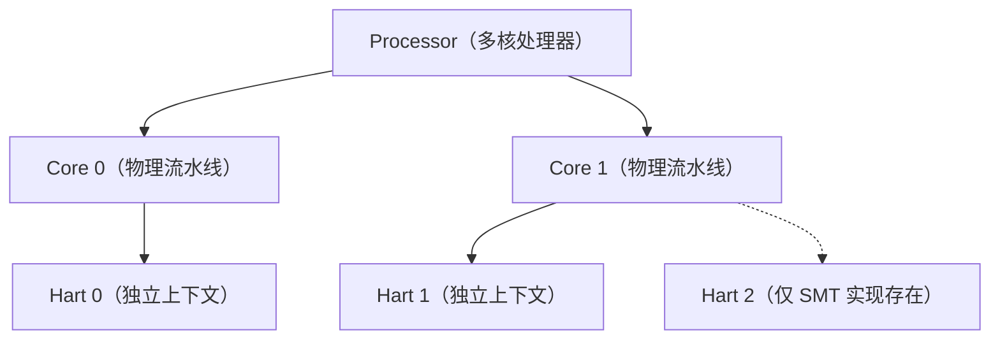

# 中断基础（MMIO / hart / MSI / CSR / domain）

> 进阶内容——AIA 规范、IMSIC/APLIC 寄存器、软件栈与开源 RTL——见 [[risc-v-aia]]。本篇只解决“这些词到底是什么意思”。

## MMIO 是什么？为什么设备寄存器要映射到内存？ #arch #interrupt #cpu

> **速查**
> - MMIO = 把设备寄存器映射进 CPU 物理地址空间，用普通 `load/store` 访问
> - 地址译码器决定这次访问去 DRAM 还是去设备；它**不是设备内存**
> - 访问可能有副作用，必须 uncached / 强序；驱动用 `volatile` 或 `readl/writel`
> - AIA 里 APLIC 寄存器是 MMIO；IMSIC 页里只有 0x000/0x004 两个 MSI 门铃是 MMIO
> - CSR 不是 MMIO：独立 12 位地址空间 + 专用指令

### 正文

**机制**

CPU 发出物理地址，总线上的地址译码器按地址区间选目标：

```text
CPU 发地址 0x0c00401c
        │
        ▼
   地址译码器
   ├─ 0x8000_0000–0x8fff_ffff → DRAM
   └─ 0x0c00_0000–0x0c00_ffff → APLIC
```

设备把自己的寄存器“挂”在这段地址上。CPU 读这个地址，就是读寄存器；写这个地址，就是写寄存器。

**例子**

```c
// APLIC 的 CLAIMI：读一次 = claim 一个中断
uint32_t irq = *(volatile uint32_t *)(APLIC_BASE + 0x4000 + 0x1c);
```

这里没有特殊 I/O 指令，就是一条普通的 load。RISC-V 没有 x86 的 `in/out` 端口 I/O，设备访问统一走 MMIO。

**为什么不能当普通内存**

| 普通内存 | MMIO |
|---|---|
| 可以缓存 | 不能缓存，必须 uncached |
| 可以乱序/合并 | 通常要求强序，至少对同一设备保序 |
| 读写只是存取 | 读写可能有副作用（claim、清 pending、门铃） |
| 值可重复读 | 有些寄存器读一次就变 |

所以驱动要用 `volatile`（阻止编译器优化）和 `readl()/writel()`（带内存屏障和端序处理），不能直接用普通指针。

**AIA 里的 MMIO 边界**

- **APLIC**：`DOMAINCFG`、`SOURCECFG`、`TARGET`、`CLAIMI` 全是 MMIO。
- **IMSIC**：4 KiB 页里只有 `0x000`（`seteipnum_le`）和 `0x004`（`seteipnum_be`）是 MMIO；`eidelivery`/`eithreshold`/`EIP`/`EIE` 是 CSR（间接）。
- **MSI**：设备或 APLIC 写 IMSIC 页 0x000，本质是总线写，但目标把它解释成“置某个 EIID 的 pending”，不是更新寄存器。

### 自测

- [ ] 为什么 MMIO 地址不能缓存？如果缓存了会发生什么？
- [ ] “MMIO 写”和“MSI 写”在总线上的形态一样，区别在哪？
- [ ] 为什么 IMSIC 的控制寄存器不做成 MMIO，而要做成间接 CSR？

---

## hart 是什么？它和 core 有什么区别？ #arch #interrupt #cpu

> **速查**
> - hart = hardware thread，拥有独立 PC、通用寄存器、CSR 和特权级的执行流
> - core 是物理流水线；一个 core 可以有 1 个或多个 hart
> - 中断和 trap 状态是 **per-hart**：`mip`/`mie`/`mepc`/`mcause` 每 hart 一套
> - IMSIC 每 hart 一个；APLIC 的 target 是 hart 索引；IPI 是 hart→hart
> - `mhartid` 标识 hart；多数简单 SoC 是 1 core = 1 hart

### 正文

**定义**

一个 hart 就是一条独立的指令执行流。它有自己的：

- PC
- x0–x31 通用寄存器
- CSR：`mstatus`、`mepc`、`mcause`、`mip`、`mie`、`satp`……
- 当前特权级（M/S/U/VS）

**三层概念先分开**

| 概念 | 属于哪一层 | 含义 |
|---|---|---|
| CPU / Processor | 泛称 | 看上下文：可指一颗芯片，也可指一个核 |
| Core | 物理实现 | 流水线、执行单元、cache，是硬件实体 |
| Hart | 架构规范 | 一条独立的执行上下文：PC / 寄存器 / CSR / 特权级 |



先按 **1 core = 1 hart** 理解，这是多数 SoC 的实际情况；支持硬件多线程（SMT）时才会出现一个 core 挂多个 hart。

**边界**：hart 是**规范里的执行上下文**，不是物理核心——hart 的数量由架构定义，不由硅片上画了几条流水线决定。所以"一个 core 两个 hart"完全合法，而"两个 core 共用一个 hart"不存在。

**标识**：`csrr a0, mhartid` 读当前 hart 的 ID。ID 唯一，但**不保证连续、也不保证从 0 开始**——启动代码给每个 hart 分配栈时，要按实际枚举到的 ID 建映射，不能假设 `hart_id == 数组下标`。

**core vs hart**

| | core | hart |
|---|---|---|
| 是什么 | 物理流水线、执行单元 | 架构可见的执行流 |
| 数量关系 | 一个 core 可含 1..N 个 hart | 一个 hart 属于一个 core |
| 软件视角 | 通常不直接暴露 | `mhartid`、每 hart 的 CSR 和中断状态 |
| 中断 | 中断最终打到 hart | 每个 hart 独立响应、独立保存现场 |

**为什么中断必须按 hart 组织**

- 中断是“打断某条执行流”，硬件必须知道打断哪个 hart。
- 每个 hart 有自己的 `mip/mie` 和 trap 现场，不能共享。
- 一个 hart 正在处理中断时，另一个 hart 可能还在跑用户程序——它们的“当前特权级”和“是否关中断”都不同。

**例子**

4 hart SoC：

- hart 0 跑 OpenSBI/启动；
- hart 1–3 跑 Linux 任务；
- 定时器中断只打 hart 1；
- hart 0 给 hart 2 发 IPI：写 hart 2 的 IMSIC 页 0x000，数据是约定 EIID。

**AIA 里的体现**

- IMSIC 每 hart 一个，内部再分 M/S/VS 文件；
- APLIC 的 `TARGET[i]` 用 hart 索引选目标；
- IPI 是“向目标 hart 的 IMSIC 发 MSI”，不是全局广播。

### 自测

- [ ] 一个 core 有 2 个 hart，`mepc` 有几个？
- [ ] 为什么不能用一个全局 `mip` 给所有 hart 共享？
- [ ] IPI 为什么不经过 APLIC？

---

## MSI 是什么？它和中断线、普通 MMIO 写有什么区别？ #arch #interrupt

> **速查**
> - MSI = 设备写一次内存来发中断：**地址选目标，数据选中断号**
> - IMSIC：地址选 hart/guest/中断文件，数据低 11 位 = EIID
> - 与中断线相比：无专用线、无共享 claim、天然按向量区分
> - 与普通 MMIO 写相比：都是总线写，但目标把它解释为“置 pending”，不是更新寄存器
> - 代价：占带宽、需要地址翻译/IOMMU、设备要支持 MSI/MSI-X

### 正文

**机制**

传统中断是“拉线”：

```text
设备 ──── IRQ 线 ────▶ 中断控制器
```

MSI 是“写内存”：

```text
设备 ──── 写地址 A、数据 D ────▶ 中断控制器
                                 └─ 把这次写解释为「中断号 D 挂起」
```

**RISC-V IMSIC 的具体编码**

```text
地址 A：IMSIC 基址 + 文件页号（由 group/hart/guest index 拼成），低 12 位为 0
数据 D：低 11 位 = EIID；其余位为 0（非 guest 场景）
```

例子：向 hart 1 的 S-file 页偏移 0x000 写数据 33：

```text
EIP[33] = 1
  → 若 EIE[33]=1、EIDELIVERY=1、33 < EITHRESHOLD
  → hart 1 的 mip.SEIP 拉起
```

**MSI vs 中断线**

| | 中断线 | MSI |
|---|---|---|
| 物理资源 | 每源/每组一根线 | 不需要专用线 |
| 区分中断 | 线号/控制器输入号 | 数据里的中断号 |
| 共享 | 可能共享、要仲裁 | 每向量独立地址/数据 |
| 虚拟化 | guest 中断常要 trap | 地址可带 guest index，直投 |
| 扩展性 | 线多、引脚多 | 按地址空间扩展 |
| 代价 | 线/引脚 | 总线带宽、地址翻译 |

**MSI vs 普通 MMIO 写**

| | 普通 MMIO 写 | MSI 写 |
|---|---|---|
| 目标 | 设备寄存器 | 中断控制器的门铃地址 |
| 效果 | 更新寄存器值 | 置某个 EIID 的 pending |
| 数据含义 | 寄存器值 | 中断号/EIID |
| 是否产生中断 | 通常不 | 是 |

两者在总线上都是“写”，区别在目标地址被谁解码、怎么解释。

**PCIe 里的 MSI/MSI-X**

- MSI：设备里有一组 address/data 寄存器，写一次发一个中断。
- MSI-X：设备里有一张表，每个向量一项 address/data，可以独立屏蔽和路由。
- 在 RISC-V 平台上，这些 address/data 最终指向 IMSIC 的文件页。

**好处与代价**

好处：

1. 不需要专用中断线，引脚少、可扩展。
2. 每个向量独立，不需要共享线仲裁。
3. 虚拟化友好：地址带 guest index，直接写 VS-file。
4. 设备直通友好：IOMMU 可以翻译 MSI 地址。

代价：

- 占总线带宽；
- 需要 IOMMU/地址翻译配合；
- 设备必须支持 MSI/MSI-X；
- 配置比“接一根线”复杂。

### 自测

- [ ] MSI 的“地址”和“数据”各决定什么？
- [ ] 为什么 MSI 比中断线更适合虚拟化？
- [ ] MSI 写和普通 MMIO 写在硬件上怎么区分？

---

## CSR 是什么？它和 MMIO 有什么区别？ #arch #interrupt #cpu

> **速查**
> - CSR = Control and Status Register，每 hart 内部的控制/状态寄存器
> - 12 位地址 + 专用 CSR 指令；地址高位编码读写属性和最低特权级
> - 权限不够或写只读 CSR → illegal instruction
> - 6 条指令：`csrrw`/`csrrs`/`csrrc` + 立即数版本；读改写原子
> - CSR 本地、per-hart、快；MMIO 总线、可共享、慢

### 正文

**为什么需要 CSR**

通用寄存器只存数据，但 CPU 还需要“控制旋钮”和“状态记录”：

- 能不能响应中断？→ `mstatus.MIE`
- 哪些中断使能？→ `mie`
- 哪些中断挂起？→ `mip`
- 上次 trap 的 PC？→ `mepc`
- 为什么 trap？→ `mcause`
- 页表基址？→ `satp`
- 当前 hart ID？→ `mhartid`

这些状态要被硬件自动更新、要按特权级保护、要 per-hart 隔离，所以单独划了 CSR 地址空间。

**地址与权限**

```text
csr[11:10]：读写属性
  00 / 01 / 10 = 可读可写
  11          = 只读

csr[9:8]：最低可访问特权级
  00 = U
  01 = S
  10 = H
  11 = M
```

例子：

| CSR | 地址 | 说明 |
|---|---:|---|
| `mstatus` | 0x300 | M 模式状态，可读写 |
| `mtvec` | 0x305 | M 模式 trap 向量 |
| `mepc` | 0x341 | M 模式 trap 返回地址 |
| `mcause` | 0x342 | M 模式 trap 原因 |
| `mhartid` | 0xF14 | hart ID，只读 |
| `sstatus` | 0x100 | S 模式状态 |
| `satp` | 0x180 | S 模式页表基址 |

**CSR 指令**

| 指令 | 语义 |
|---|---|
| `csrrw rd, csr, rs1` | `rd = csr`；`csr = rs1` |
| `csrrs rd, csr, rs1` | `rd = csr`；`csr = csr \| rs1` |
| `csrrc rd, csr, rs1` | `rd = csr`；`csr = csr & ~rs1` |
| `csrrwi rd, csr, zimm` | 写 5 位立即数 |
| `csrrsi rd, csr, zimm` | 置位 |
| `csrrci rd, csr, zimm` | 清零 |

伪指令：

```asm
csrr t0, mstatus      # csrrs t0, mstatus, x0
csrw mstatus, t0      # csrrw x0, mstatus, t0
csrs mstatus, t0      # 置位
csrc mstatus, t0      # 清零
```

关键点：

1. **一条 CSR 指令原子**：读和写之间不会插入中断。AIA 的 claim 靠这个性质。
2. `rd = x0` 表示不读；`rs1 = x0` 表示写 0。
3. `csrrs/csrrc` 的 `rs1 = x0` 表示只读、不写。
4. CSR 指令本身不是特权指令，但访问受特权级检查。

**CSR vs MMIO**

| | CSR | MMIO |
|---|---|---|
| 位置 | hart 内部 | 总线上的设备 |
| 访问 | 专用 CSR 指令 | `load/store` |
| 地址空间 | 12 位 CSR 编号 | 物理地址空间 |
| 权限 | CPU 按特权级检查 | CPU 不管；总线/IOMMU 可能管 |
| 速度 | 快，本地 | 慢，可能跨总线 |
| 共享 | per-hart | 设备可被多个 hart 共享 |
| 副作用 | 写可以有；读一般不允许有 | 读写都可能有 |

**AIA 里的用法**

- **IMSIC 控制**：`eidelivery`、`eithreshold`、`EIP`、`EIE` 通过间接 CSR 访问。
- **claim**：`csrrw rd, stopei, x0` 一条指令读最高优先级并清 pending。
- **APLIC 寄存器**：MMIO，因为 APLIC 是平台共享设备。
- **MSI 门铃**：MMIO，因为设备要通过总线写。

**间接 CSR**

CSR 地址只有 12 位，AIA 的 IMSIC 寄存器太多，于是用“选择寄存器 + 数据寄存器”扩展：

```asm
li t0, 0x70          # 选择 eidelivery
csrw siselect, t0
li t0, 1
csrw sireg, t0       # eidelivery = 1
```

| 特权级 | 选择 | 数据 |
|---|---|---|
| M | `miselect` | `mireg` |
| S | `siselect` | `sireg` |
| VS | `vsiselect` | `vsireg` |

AIA 的 IMSIC 选择号：0x70 `eidelivery`、0x72 `eithreshold`、0x80–0xBF `EIP0–63`、0xC0–0xFF `EIE0–63`。

> 这些是**选择号**，不是 MMIO 偏移。IMSIC 的 4 KiB 页里只有 0x000/0x004 是 MMIO。

**trap 与 CSR**

trap 时硬件自动写：

```text
mepc/sepc   ← 下一条 PC
mcause/scause ← 中断位 + cause code
mstatus.MPIE ← 原 MIE；MIE ← 0
mstatus.MPP  ← 原特权级
```

软件读这些 CSR 判断原因；`mret/sret` 再读 `mepc/mstatus` 恢复现场。

### 自测

- [ ] 为什么 AIA 的 claim 用 `csrrw stopei, x0`，而不是先读再写？
- [ ] CSR 地址的高 4 位分别编码什么？
- [ ] 访问一个低于当前特权级的 CSR 会发生什么？
- [ ] 间接 CSR 解决了什么问题？

---

## APLIC 的 domain 分层是什么？ #arch #interrupt

> **速查**
> - APLIC 的 domain 是中断分区树：root + child
> - root 拥有所有源，通过 `SOURCECFG.D` / `CHILD_INDEX` 把源委派给 child
> - 每个 domain 固定投递模式、目标 hart、目标特权级
> - child 0 通常给 S 模式；其他 child 给多 OS/安全域
> - 没有 IMSIC 时，一个 hart 的一个特权级只能属于一个 domain

### 正文

**结构**

```text
root domain（根域）
├─ child 0   → 通常给 S 模式 / Linux
├─ child 1   → 另一个 OS / 安全域
└─ child 2   → 另一个 guest / 实时域
```

每个 domain 有自己的一套寄存器：

- `DOMAINCFG`：投递模式（direct/MSI）、全局使能、端序
- `SOURCECFG[i]`：每个源的模式/委派
- `TARGET[i]`：目标 hart / guest / EIID
- 自己的 MMIO 基址

**源怎么移动**

```text
root 一开始拥有所有源 1–1023
        │
        │ SOURCECFG[i].D = 1
        │ CHILD_INDEX = 0
        ▼
child 0 拥有源 i
```

- `D=1` 表示“委派给子域”；
- `CHILD_INDEX` 指定子域编号；
- 一个源在同一时刻只属于一个 domain；
- root 先处理所有中断，再按委派交给 child。

**例子**

```text
root domain
├─ child 0（S 模式 / Linux）：源 1–64
├─ child 1（安全 OS）：源 65–96
└─ root 自己保留：源 97–1023（M 模式固件用）
```

**为什么分层**

1. **M/S 隔离**：M 模式固件和 S 模式 OS 各自管理自己的源。
2. **多 OS / 安全域**：Linux、RTOS、安全 OS 各自有独立 domain。
3. **不同投递策略**：一个 domain direct，另一个 domain MSI。
4. **不同目标特权级**：domain 可以固定投给 M、S 或 VS。

**domain 不是特权级**

- domain 是 APLIC 的“分区”；
- 特权级是 CPU 的 M/S/U/VS；
- 一个 domain 会配置“我投给哪个特权级”，但两者不是同一个东西。

**约束**

- 没有 IMSIC：一个 hart 的一个特权级只能属于一个 domain。
- 有 IMSIC：M/S/VS 文件分开，同一个 hart 可以同时服务多个域。

### 自测

- [ ] root 和 child 之间，源是怎么“移动”的？
- [ ] 为什么 child 0 通常给 S 模式？
- [ ] domain 和 CPU 特权级是什么关系？

---

## direct 投递（类 PLIC）是什么？ #arch #interrupt

> **速查**
> - direct = APLIC 拉一根外部中断线给 hart；hart 进 trap 后 MMIO 读 `CLAIMI`
> - 软件模型像 PLIC：claim 拿源号 → 处理 → 返回
> - APLIC 比 PLIC 多 domain、源类型配置；没有独立 complete 寄存器
> - level 源 pending 跟随输入，claim 清不掉；edge 源 claim 可清
> - 适合简单 SoC / 替代 PLIC；虚拟化差，guest 访问会 trap

### 正文

**流程**

```text
设备 IRQ
  → APLIC gateway 置 pending
  → APLIC 按 IPRIO/ITHRESHOLD 选最高优先级
  → APLIC 拉高目标 hart 的外部中断线
  → hart 的 mip.MEIP 或 mip.SEIP = 1
  → hart 进入 trap
  → 软件读 APLIC IDC 的 CLAIMI（MMIO）
  → 拿到源号，清 pending（如果可能）
  → 执行 handler
  → level 源：让设备 deassert；edge 源：等下一个边沿
  → mret/sret
```

**为什么叫“类 PLIC”**

| | PLIC | APLIC direct |
|---|---|---|
| 中断线 | 有 | 有 |
| claim | 读 PLIC claim/complete | 读 APLIC `CLAIMI` |
| complete | 写 claim/complete | 没有独立 complete；由源类型决定 |
| 源配置 | 基本只有电平 | edge/level 可配 |
| 分区 | 无 domain | 有 domain 树 |
| 虚拟化 | 差，guest 要 trap | 也差，guest 要 trap |

“类 PLIC”是说**软件处理方式像 PLIC**：进 trap 后读一个 claim 寄存器拿中断号，处理完返回。但寄存器模型、domain、源配置都比 PLIC 复杂。

**level 源与 edge 源**

- **level**：pending 是输入电平的副本。输入一直高，claim 也清不掉；handler 必须让设备 deassert，否则会立刻再进中断。
- **edge**：gateway 检测边沿置 pending；claim 可以清掉；等下一个边沿才会再 pending。

**direct mode 适合谁**

- 简单 MCU、RTOS；
- 没有 IMSIC 的平台；
- 想平滑替换 PLIC 的 SoC；
- 不需要虚拟化的场景。

**缺点**

- 每个 hart 一根线，核多时线多；
- handler 里要 MMIO claim，虚拟化时 guest 访问会 trap；
- 亲和性靠改 target，动态调整不如 MSI 灵活。

### 自测

- [ ] level 源 claim 之后为什么还可能立刻再触发？
- [ ] direct mode 为什么没有独立的 complete 寄存器？
- [ ] 什么场景应该选 direct 而不是 MSI？

---

## 一条中断从设备到 sret 的完整流程 #arch #interrupt

> **速查**
> - 通用 trap：硬件写 `mepc/mcause/mstatus`；软件保存上下文、claim、处理、`mret/sret`
> - direct：设备 → APLIC → hart 线 → `CLAIMI` → handler
> - MSI：设备/APLIC → IMSIC EIP/EIE → hart → `csrrw stopei` → handler
> - IPI：写目标 hart 的 IMSIC 0x000；虚拟化：guest index → VS-file
> - 完成语义：MSI/edge 在 claim 清；level 要让设备 deassert

### 正文

**通用 trap 流程**

```text
① 中断控制器置起 hart 的 mip.MEIP / mip.SEIP
② 硬件在指令边界检查 mip & mie & 全局使能 & 特权级
③ 取最高优先级中断
④ 硬件保存现场：
     mepc/sepc   ← 下一条 PC
     mcause/scause ← 最高位=1，低位=cause code
     mstatus.MPIE ← 原 MIE；MIE ← 0
     mstatus.MPP  ← 原特权级
⑤ 跳到 mtvec/stvec
⑥ 软件保存通用寄存器
⑦ 识别中断源 + claim
⑧ 执行 handler
⑨ 完成/清 pending
⑩ 恢复寄存器，mret/sret
```

**谁做什么**

| 阶段 | 谁做 |
|---|---|
| 置 pending、仲裁、拉线/发 MSI | 中断控制器硬件 |
| 检查 `mip/mie/mstatus`、保存 `mepc/mcause`、跳 vector | hart 硬件 |
| 保存通用寄存器、claim、dispatch、处理设备 | 软件 |
| 清 pending / 让设备 deassert | 软件 + 设备 |
| 恢复现场、`mret/sret` | 软件 + hart 硬件 |

**流程 A：direct mode**

```text
设备拉高 IRQ
  → APLIC gateway 置 pending
  → APLIC 选最高优先级
  → 拉高 hart 外部中断线
  → sip.SEIP = 1
  → S 模式 trap（scause = 0x80000009）
  → 软件保存上下文
  → 读 APLIC CLAIMI（MMIO）
  → 按源号查表，调用 handler
  → level 源让设备 deassert；edge 源等下一个边沿
  → 恢复上下文，sret
```

**流程 B：MSI mode**

```text
设备/APLIC 发起 MSI 写：
  地址 = IMSIC 目标文件页
  数据 = EIID
  → IMSIC 置 EIP[EIID]
  → 检查 EIE[EIID]、EIDELIVERY、EITHRESHOLD
  → 拉高 hart 本地外部中断
  → mip.SEIP 或 mip.MEIP = 1
  → hart 进入 trap
  → csrrw rd, stopei, x0
  → 返回最高优先级 EIID；写触发 claim，清对应 EIP
  → 按 EIID 查表，调用 handler
  → level 设备让设备 deassert；APLIC gateway 若仍高会再发 MSI
  → 恢复上下文，sret/mret
```

**流程 C：IPI**

```text
hart 0 写 hart 2 的 IMSIC 页 0x000，数据 = 约定 EIID
  → hart 2 的 EIP[EIID] = 1
  → hart 2 进 trap，stopei claim
  → 执行 IPI handler
```

AIA 平台上的 IPI 就是“向目标 hart 发一条 MSI”，不再依赖 CLINT 的 `msip`。

**流程 D：虚拟化**

```text
guest 设备/软件发 MSI，地址带 guest index
  → 写入该 guest 的 VS-file
  → VS-file 按自己的 EIE/EITHRESHOLD 仲裁
  → 通过 hvictl/hviprio 注入 guest
  → guest 在 VS 模式 trap，读 VS 级的 vstopei/vstopi
  → guest handler 处理
```

KVM 两种模式：HWACCEL（硬件 VS-file）和 EMUL（trap 模拟）。设备直通还需要 IOMMU 翻译 guest MSI 地址。

**三种路径对比**

| | PLIC | APLIC direct | APLIC MSI + IMSIC |
|---|---|---|---|
| 中断怎么来 | 设备拉线 | 设备拉线 | 设备/APLIC 写内存 |
| 控制器 | 全局 PLIC | APLIC domain | APLIC + 每 hart IMSIC |
| claim | MMIO claim/complete | MMIO `CLAIMI` | CSR `stopei` |
| 优先级 | PLIC priority | `IPRIO`，越小越高 | `EIID`，越小越高 |
| 虚拟化 | 差 | 差 | 好，VS-file 直投 |
| 适合 | 简单 SoC | 替代 PLIC | Linux/KVM/多 hart |

### 自测

- [ ] direct 和 MSI 两条路径，claim 分别发生在哪里？
- [ ] level 源在 direct 和 MSI 下分别由谁负责“让中断消失”？
- [ ] IPI 为什么不需要 APLIC？
- [ ] trap 入口硬件更新哪些 CSR？

---

## 面试速查：一句话版本 + 常见误解 #arch #interrupt

> **速查**
> - MMIO：设备寄存器映射进物理地址空间，用 load/store 访问，有副作用
> - hart：硬件线程，独立 PC/CSR/特权级；中断状态 per-hart
> - MSI：写内存发中断，地址选目标、数据选中断号
> - CSR：hart 内部的控制/状态寄存器，12 位地址 + 专用指令
> - domain：APLIC 的中断分区树；direct：APLIC 拉线，类 PLIC

### 正文

**一句话版本**

| 概念 | 一句话 |
|---|---|
| MMIO | 把设备寄存器映射进 CPU 物理地址空间，用普通 load/store 访问；地址译码决定去内存还是设备。 |
| hart | RISC-V 的硬件线程，拥有独立 PC、寄存器和 CSR；中断和 trap 状态 per-hart。 |
| MSI | 设备通过一次内存写发中断：地址选目标 hart/guest，数据选中断号。 |
| CSR | 每个 hart 内部的控制/状态寄存器，用专用 CSR 指令访问，受特权级保护。 |
| domain | APLIC 的中断分区树：root 拥有所有源，通过委派把源交给 child。 |
| direct | APLIC 拉一根外部中断线给 hart，hart 用 MMIO `CLAIMI` claim，软件模型像 PLIC。 |

**常见误解**

| 误解 | 实际 |
|---|---|
| “MMIO 就是设备内存” | 是设备寄存器的地址映射；访问有副作用，不能缓存 |
| “hart 就是 core” | core 是物理流水线，hart 是架构执行流；一个 core 可有多个 hart |
| “MSI 就是普通 MMIO 写” | 都是总线写，但 MSI 的目标把它解释为中断，不是寄存器更新 |
| “CSR 是内存地址” | CSR 有独立 12 位编号和专用指令，不在物理地址空间 |
| “CSR 读一般有副作用” | 标准 CSR 读不应有副作用；AIA 的 claim 用写副作用 |
| “domain 就是特权级” | domain 是 APLIC 分区；特权级是 CPU 的 M/S/U/VS |
| “direct 就是 PLIC” | 软件模型像，但 APLIC 有 domain、源类型配置，且没有独立 complete |

**答题顺序**

1. 先给定义（一句话）。
2. 画路径（设备 → 控制器 → hart → trap → handler）。
3. 说软件/硬件分工（谁置 pending、谁 claim、谁清 pending）。
4. 说取舍（direct vs MSI、CSR vs MMIO、有/无 IMSIC）。
5. 最后补一个陷阱或边界（level 源、EIID 优先级方向、XLEN=64 奇数寄存器）。

**延伸**

- AIA 规范细节、IMSIC/APLIC 寄存器、Linux/OpenSBI/QEMU/KVM 软件栈、开源 RTL 盘点：[[risc-v-aia]]。

### 自测

- [ ] 不看笔记，能否用 30 秒解释 MMIO、hart、MSI、CSR、domain、direct？
- [ ] 面试官说“EIID 越大优先级越高”，你怎么纠正？
- [ ] 如果让你画 direct 和 MSI 两条路径，能否标出 claim 的位置？
- [ ] 为什么 AIA 的 claim 必须用一条 `csrrw`？
