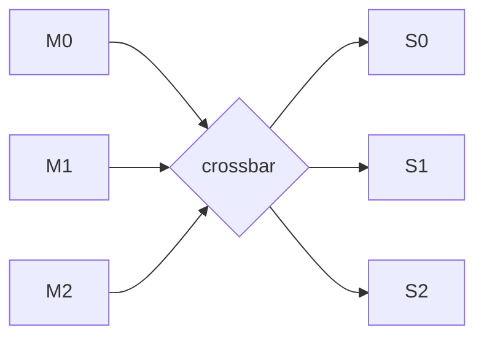
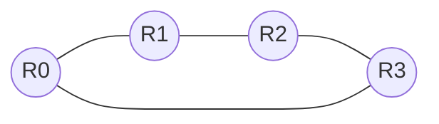
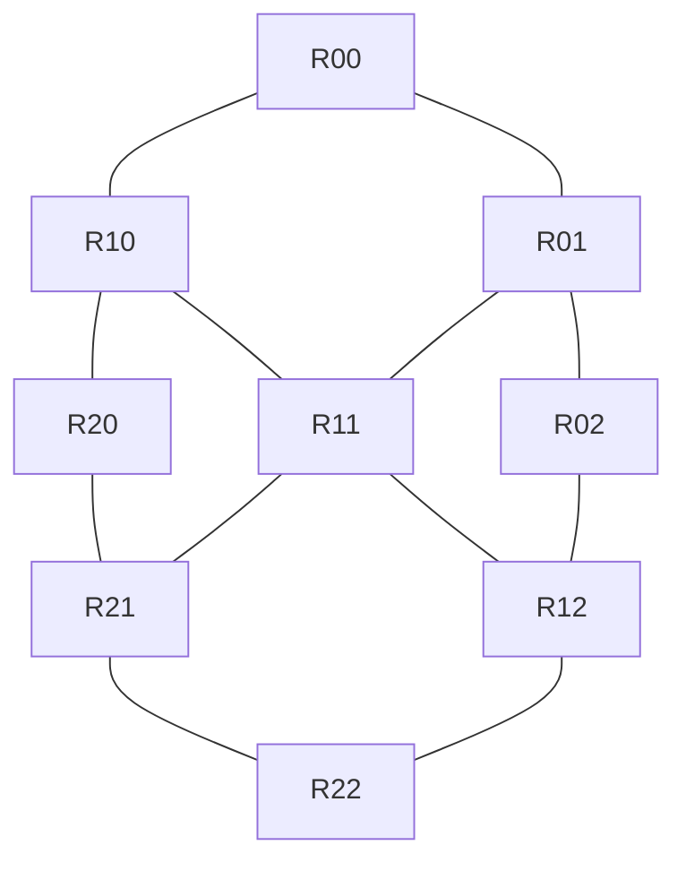
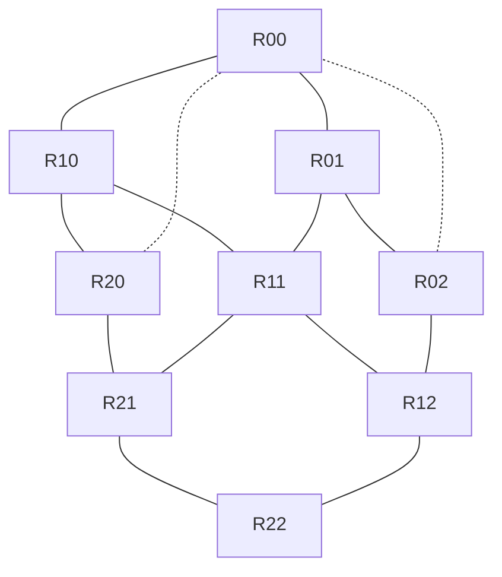
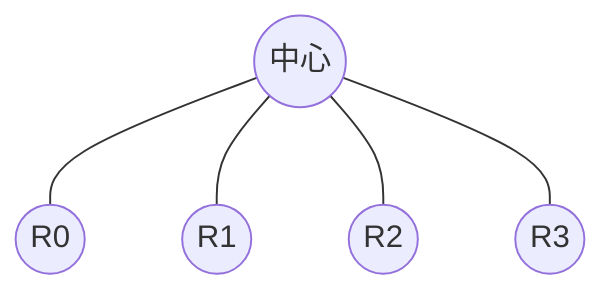
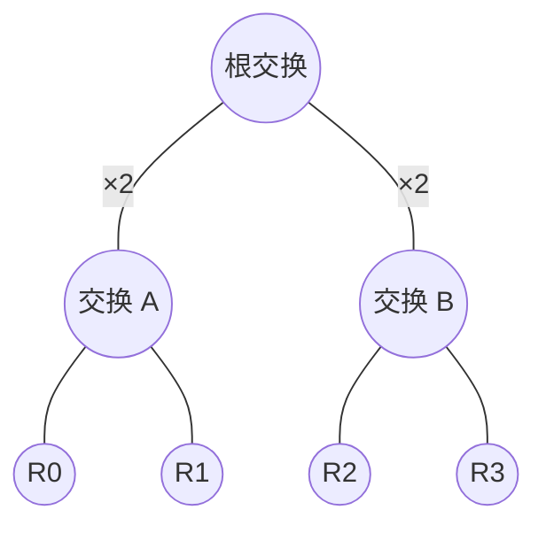

# SoC NoC 背诵卡

> **用途**：Day 1（10-27）复习材料。上半按「协议 → 拓扑 → 路由器 → 性能 → 一致性」五层展开，下半是 20 道背诵题 + 3 分钟口述模板。
> **配套**：[[2026-10-27-SoC架构-三天复习计划]] · [[soc-architecture#总线、crossbar、NoC 怎么选？带宽怎么估？]]（知识图谱版，更短）
>
> **⏱ 只有 1 小时怎么读**：§一 五层（5 min）→ §二 的 AXI 表 + CHI（15）→ §三 拓扑（10）→ §四 路由器（15）→ §五 性能，跟着算一遍（10）→ §六 一致性（5）。§二 的 AHB/APB、§八 口述模板、§九 易错点留到晚上；§七 是题库，白天不看。

## 一、五层模型：先记住这一张

一句话：**协议定事务怎么握手，拓扑定谁连谁，路由器定一笔数据怎么走，性能是前四层的算术结果，一致性是跨 cache 的正确性约束。**

```
一致性   ← CHI / ACE        （谁能缓存、什么时候失效）
协议     ← AXI / AHB / APB  （一次事务怎么握手）
拓扑     ← bus / crossbar / NoC（谁连谁、几跳）
路由器   ← buffer / VC / 仲裁 / crossbar（包怎么转发）
链路     ← 位宽、SerDes、跨时钟（电信号怎么过去）
```

面试讲 NoC，按这五层从上往下说，就不会漏。

## 二、协议层

### AXI4：背这张表

| 字段 | 含义 | 记忆点 |
|---|---|---|
| `AxLEN` | burst 长度 **− 1** | 8 bit，1~256 beats |
| `AxSIZE` | 每 beat 字节数 = `2^AxSIZE` | **不能超过数据总线宽度** |
| `AxBURST` | FIXED / INCR / WRAP | 地址怎么递进 |
| `AxID` | 事务标识 | **同 ID 保序，不同 ID 可乱序** |
| `AxQOS` | 4 bit 优先级 | 只是提示，用不用由仲裁器决定 |
| `AxCACHE` | bufferable / cacheable / allocate | 决定互连能不能合并、缓存 |
| `AxPROT` | privileged / secure / instruction | **`AxPROT[1]` 就是 TrustZone 的 NS 位** |

**五通道**：AW（写地址）、W（写数据）、B（写响应）、AR（读地址）、R（读数据）。

| 要点 | 说明 |
|---|---|
| 为什么要读写分离 | 读写可以并发，链路利用率高；代价是面积 + 跨方向顺序要靠 barrier |
| 握手规则 | `VALID` 与 `READY` 同时为高才成交；**`VALID` 不能等 `READY`**（会形成组合环） |
| 一笔写几个 B 响应 | AXI4 一笔 burst 一个 B 响应（AXI4 取消了写数据交织） |
| 乱序靠什么 | `AxID`；同 ID 必须按序完成，不同 ID 可以穿插 |

### AHB / APB / CHI

| 协议 | 结构 | 用途 |
|---|---|---|
| AHB | 地址阶段 + 数据阶段流水，`HREADY` 反压 | 中速外设、老 IP |
| APB | setup + access 两拍，`PREADY` 反压 | **寄存器**，面积最小 |
| AXI | 五通道、burst、乱序 | 高带宽主干 |
| CHI | 包交换、四通道、带一致性 | 多 cluster / 多核 |

CHI 四通道：**REQ / RSP / DAT / SNP**。
节点类型：RN-F（全一致请求）、RN-I（I/O 请求）、HN-F（全一致 home，带 snoop filter）、SN-F（从节点）。

**AXI 与 CHI 的根本差别**：AXI 是**非一致**的点对点连接，CHI 是**带一致性**的包交换网络，天然支持多跳。

## 三、拓扑层

| | 共享总线 | crossbar | NoC |
|---|---|---|---|
| 并发 | 同一时刻 1 对 | N×M（端口够时无阻塞） | 多对并发 |
| 面积 | O(N+M) | **O(N×M)** | O(N) 路由器 + 链路 |
| 延迟 | 仲裁 + 传输 | 1 跳 | 跳数 × 每跳 |
| 失效点 | 带宽先满 | 连线/面积 | 布线、功耗 |
| 典型用途 | APB 外设 | 中小 SoC 主干 | 大 SoC / 多 cluster |

**常见拓扑**：

| 拓扑 | 直径 / 级数（N 节点） | 优点 | 缺点 | 主要瓶颈 |
|---|---|---|---|---|
| ring | `⌊N/2⌋`（双向）；`N−1`（单向） | 布线最省、端口少 | 节点一多跳数线性涨 | 跳数、链路带宽 |
| mesh | `2(k−1)` = O(√N) | 布局规整、路由简单、易扩展 | 边界节点度低、中心易拥塞 | 中心拥塞、边界不均衡 |
| torus | `2⌊k/2⌋` = O(√N) | 直径约减半、路径多 | 回绕长线、时序难收 | 回绕长链路 |
| star | 1 | 一跳 | 中心即瓶颈 | 中心带宽 |
| tree | O(log N) | 层级清晰、易组织大规模 | 上层链路瓶颈 | 上层链路 |
| fat-tree | O(log N) | 上层链路加宽，对分带宽高 | 交换与布线成本高 | 成本 |
| butterfly | O(log N) 级 | 级数少 | 内部链路竞争，**非天然无阻塞** | 内部链路竞争 |

> 表里的直径是**最短路径跳数**，不是延迟。实际延迟 = 跳数 × 每跳流水 + 串行化 + 排队。
> 所以 torus 直径更小，不代表端到端一定更快——长线时序和拥塞能吃掉收益。

**为什么不全用 crossbar**：N 个 master × M 个 slave 要 N×M 个交叉点，64×64 时连线和面积先爆，而大多数连接长期空闲。NoC 用共享链路换面积，代价是跳数延迟。

**选型速查**（换一张表看：成本 / 扩展性 / 瓶颈）

| 拓扑        | 路径长度趋势        | 布线成本 | 扩展性 | 主要瓶颈        |
| --------- | ------------- | ---- | --- | ----------- |
| ring      | O(N)          | 低    | 一般  | 跳数、链路带宽     |
| 2D mesh   | O(√N)         | 中    | 好   | 中心拥塞、边界不均衡  |
| 2D torus  | O(√N)         | 中~高  | 好   | 回绕长链路、路由复杂度 |
| tree      | O(log N)（平衡树） | 中    | 好   | 上层链路        |
| fat-tree  | O(log N)      | 高    | 好   | 交换与布线成本     |
| crossbar  | 逻辑上单级交换（1 跳）  | 高    | 差   | 面积、端口、布线    |
| butterfly | O(log N) 级    | 中~高  | 好   | 内部链路竞争      |

> 上面那张表回答"长什么样、为什么这样连"；这张回答"选谁"。两张一起看，只背其中一张都会在追问时露馅。

### 看图记（实线 = 一跳链路，虚线 = 环回长线）

**基线：crossbar**——全连、1 跳、N×M 个交叉点。下面的 NoC 拓扑都是"少连一点、多走几跳"的变体。



**ring**——N 个节点首尾相接。连线最省，直径 N/2，节点一多延迟线性涨。



**mesh**（3×3 示意）——只连上下左右。直径 2(k−1)，布局规整，是 CMN / CPU cluster 的默认形态。



**torus**——在 mesh 上加首尾环绕（虚线）。直径约减半，代价是跨全芯片的长线，时序难收。



> 图里只画了横向和纵向各一条环绕线，另外两侧同理。看这张图要能说出"torus = mesh + 两条长线"。

**star**——所有节点连一个中心。1 跳，但中心节点的带宽就是整个网络的上限，等价于一个 crossbar。



**tree / fat-tree**——叶子是节点，上层是交换器。普通树越往上链路越少，上层就是瓶颈；fat-tree 把上层链路**加宽**（图中 `×2`）或增加并行路径，对分带宽随之提高。



**butterfly**——多级交换：每一级把一半输入接到另一半输出，路径级数 O(log N)。它**不是天然无阻塞**：不同流可能争同一条内部链路；Beneš（末尾加一级反向）才是可重排无阻塞。

> 记图口诀：**ring 圈、mesh 格、torus 格加环、star 伞、tree 层、butterfly 多级**；crossbar 是"全连"，NoC 是"少连多跳"。

**两个最容易混的概念**：

1. **拓扑 ≠ 路由算法**。mesh 是拓扑；XY 是一种能跑在 mesh 上的路由算法。同一拓扑可以换算法（XY / 自适应），同一算法也能跑在多种拓扑上。
2. **直径 ≠ 延迟**。直径只数跳；延迟还要加每跳流水、链路传播、仲裁和排队。回答"torus 比 mesh 快吗"要说"取决于链路时序和拥塞"，不能只比跳数。

## 四、路由器

五级流水，顺序要背下来：

| 缩写 | 全称 | 中文 | 在做什么 | 谁执行 |
|---|---|---|---|---|
| **RC** | Routing Computation | 路由计算 | 用头 flit 的目的地址算出输出端口（查表或 XY 算法） | **只有头 flit** |
| **VA** | Virtual Channel Allocation | 虚拟通道分配 | 向下游预约一条 VC，决定这个包排在哪个队列 | **只有头 flit** |
| **SA** | Switch Allocation | 开关分配（仲裁） | 多个输入争用同一出口时，决定本周期谁过 | 所有 flit |
| **ST** | Switch Traversal | 开关传输 | 真的穿过 crossbar，到达输出端口 | 所有 flit |
| **LT** | Link Traversal | 链路传输 | flit 在链路上走到下一个路由器（或目的端） | 所有 flit |

> **关键**：RC 和 VA 是**包级**决策，只有头 flit 做；后续 body flit 直接复用已建立的路径，只走 SA / ST / LT。
> 这也是"五级流水"里最容易被讲错的一点。

```
头 flit：  RC → VA → SA → ST → LT
body flit：            SA → ST → LT
```

**物理位置**：buffer / RC / VA / SA 都在**输入侧**（先决定，再穿过）；ST 是穿过 crossbar；LT 是走上链路到下一跳。
所以流水线的起点是**输入端口**，不是出口端。

**lookahead routing 的例外**：下一跳的路由在上游路由器的**输出侧**就算好、随头 flit 带过去，
于是下游路由器上来直接从 VA 开始——这是"从出口端开始"唯一成立的说法。

| 部件 / 机制 | 作用 | 为什么需要 |
|---|---|---|
| input buffer | 每个输入端口一组 FIFO，存 flit | 吸收反压、解耦上下游 |
| **VC（virtual channel）** | 一个物理端口切出多条逻辑队列 | 解决 **head-of-line blocking**；也是避死锁的手段 |
| credit 流控 | 下游上报空位，上游发一个扣一个 | 长链路上不必每拍往返一次 ready |
| 仲裁 | RR / 加权 RR / 优先级 | QoS 在这里落地 |
| crossbar | 把输入接到输出 | 单周期交换 |

**死锁的三个来源**：

1. **路由死锁**（环形依赖）→ 维序路由（先 X 后 Y）打破环；
2. **协议死锁**（请求等响应、响应又被请求堵住）→ 请求和响应走不同 VC；
3. **树饱和**（所有流量打同一个热点）→ 限流、加 VC、把目标分散。

## 五、性能：四个公式 + 一组验算

```
链路峰值带宽 = 位宽 ÷ 8 × 频率
有效带宽     = 峰值 × 效率（0.6 ~ 0.8）
端到端延迟   ≈ 跳数 × 每跳延迟 + 串行化时间 + 排队
在途事务数   = 带宽 × 往返延迟 ÷ 每笔大小      （Little's law）
```

**验算（8×8 mesh，128-bit 链路 @ 1 GHz）**：

- 单链路：`16 B × 1e9 = 16 GB/s`（每方向）
- 直径：最远两点 `7 + 7 = 14` 跳
- **对分带宽**：从中间竖切，切断 8 条链路 → `8 × 16 = 128 GB/s`
- outstanding：`16 GB/s × 300 ns = 4.8 KB`，按 64 B 一笔 → 约 **75 笔**

> 对分带宽不是"总带宽"，是**最坏割**——所有节点两两通信时，跨过这条切口的流量上限。

## 六、一致性

| 概念 | 内容 |
|---|---|
| MESI | **M**odified（独占且脏）/ **E**xclusive（独占且干净）/ **S**hared / **I**nvalid |
| snoop | 每次写广播问一圈"谁有这一行"；小规模简单，大规模流量爆炸 |
| directory | home 节点记录"哪个 cache 有哪一行"；CHI 的 HN-F 就是这个 |
| snoop filter | 目录的一种实现，避免全广播 |
| ACE | AXI 上加 AC（snoop 地址）、CR（snoop 响应）、CD（snoop 数据）和 barrier |
| 加速器为什么常非一致 | 省面积和布线；代价是驱动必须手动 flush / invalidate |

## 七、背诵题（20 道）

> 要求：每题 **5 秒内**开口，答案控制在 1~3 句。

1. **AXI 五个通道？** AW / W / B / AR / R。
2. **AXI 怎么支持乱序？** 靠 `AxID`：同 ID 保序，不同 ID 可乱序完成。
3. **`AxLEN` / `AxSIZE` / `AxBURST` 各是什么？** 长度减一 / 每 beat 字节数的 log2 / FIXED·INCR·WRAP。
4. **为什么读写通道分离？** 读写并发提高利用率；代价是面积和跨方向顺序要靠 barrier。
5. **`VALID` 能等 `READY` 吗？** 不能，会形成组合环；`VALID` 必须先拉高。
6. **共享总线 / crossbar / NoC 的适用规模？** ≤4 / 约 4~32 / >32 个 master。
7. **crossbar 面积为什么是 O(N×M)？** 每对输入输出都要独立通路和仲裁。
8. **路由器五级流水？** RC → VA → SA → ST → LT。
9. **VC 解决什么？** head-of-line blocking；同时用来避死锁。
10. **credit 流控怎么工作？** 下游报空位数，上游发一个扣一个，收到 credit 才能再发。
11. **死锁的三种来源？** 路由环、协议环（请求/响应互等）、热点树饱和。
12. **XY 路由为什么无死锁？** 维序：先走完 X 再走 Y，不可能成环。
13. **链路带宽怎么算？** 位宽 ÷ 8 × 频率；有效带宽再乘 0.6~0.8。
14. **Little's law 在互连里怎么用？** 在途事务数 = 带宽 × 延迟 ÷ 每笔大小，决定 MSHR / 事务表深度。
15. **对分带宽是什么？** 把网络对半切，所有被切断链路的带宽之和，衡量最坏拥塞。
16. **`AxQOS` 够不够做 QoS？** 不够，只是 4 bit 提示；真要 QoS 得靠 VC 分级 + 预留带宽 + 限流。
17. **MESI 四态？** M / E / S / I。
18. **snoop filter 干什么？** 记录哪个 cache 持有某行，避免每次写都全广播。
19. **CHI 四个通道？** REQ / RSP / DAT / SNP。
20. **为什么加速器常不用一致端口？** 面积和布线代价；用软件 flush / invalidate 换简单。

## 八、口述模板：介绍一下 NoC（3 分钟）

按五层讲，每层一句定义 + 一个取舍：

1. **是什么**：NoC 用路由器和链路把片上 master / slave 连起来，解决大规模下 crossbar 的面积和布线问题。
2. **协议**：主干用 AXI（非一致、五通道、靠 ID 乱序）；多核 cluster 用 CHI（包交换、带一致性）。
3. **拓扑**：中小规模 crossbar 更划算；超过几十个节点上 mesh，环形省线但延迟随节点数涨。
4. **路由器**：五级流水，VC 解决队头阻塞，credit 流控适配长链路，XY 路由避路由死锁。
5. **性能**：峰值 = 位宽 × 频率，有效乘 0.6~0.8；够不够用 Little's law 反推 outstanding；最坏情况看对分带宽。
6. **落回项目**：说一个你见过的拓扑选择和瓶颈（带宽竞争 / 热点 / 跳数延迟）。

## 九、易错点（答错这三条会被扣分）

- `AxLEN` 是**长度减一**，不是长度。
- AXI 的"同 ID 保序"是**事务级**的，不是 flit 级。
- credit 和 ready/valid 不是一回事：credit 是**预算**，ready 是**当下能不能收**。
- 对分带宽不是总带宽，是**最差割**。
- CHI 的 `SNP` 通道传的是 snoop 请求，不是数据。
- Coresight 是**调试/追踪**子系统，不是总线——JD 里和 NoC 并列，别答错。

## 十、明天衔接

Day 2 会用到今天的两块：**`AxPROT[1]`（NS 位）** → TrustZone；**`AxID` / 事务顺序** → 一致性与内存模型。今天顺手在脑子里留个钩子。
